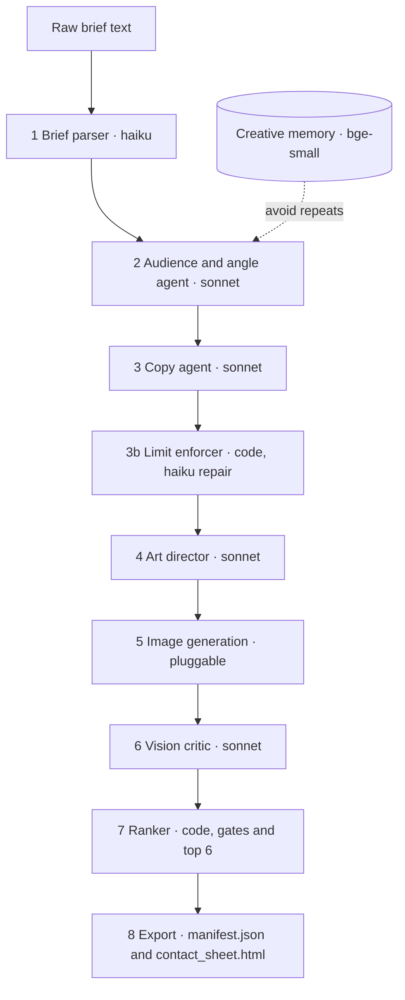

# ad-creative-agent

Live demo: https://erenes1667.github.io/ad-creative-agent/ (serves `docs/`). Repo: https://github.com/erenes1667/ad-creative-agent

In short: a brief goes in, ranked ad concepts with copy come out. Text, judging and ranking ran live. The pipeline's own images are placeholders; 6 real images came from ChatGPT, made by hand. Every number below is in `results/`.

**A copy, evaluation and judging pipeline for ad creative.** The image step is a plug that has not run live through the API. A launch brief goes in. Out come scored ad concepts: three audiences, three hooks each, copy for Meta, TikTok and Google UAC, a vision critic, and a ranked top 6 with reasons.

**The judge is unvalidated against humans, and its platform-fit score is unreliable.** **Best numbers (all in `results/`, all from self-built tests with small n):** judge found the planted flaw in 5 of 5 weak copy sets (I planted them); vision critic blocked 12 of 12 model-caught seeded defects and passed the 1 control (3 more aspect-ratio defects are caught by plain code; I made the defects, and 1 control gives no false-alarm rate); creative memory cut near-duplicate angles from 9 to 0 (3 trials per arm, threshold tuned on the same brief); mean cost $0.3472 per brief; 0 of 108 concepts broke a length limit.

**Image gap: the image API adapters have not run live.** Six real images exist: ChatGPT (GPT image), run by hand through the web app on 2026-10-24, one chat per concept, from the Tidebreak art-director prompts (`runs/tidebreak-20261024-021544/images_gpt/`). The vision critic scored them (`results/vision_real_gpt.json`). The pipeline did not generate them. The only OpenAI API key returned 401, no diffusion server answered on ports 7860 or 8188, and no accounts may be created. The pipeline's own images stay placeholders (typography plus procedural SVG). Adapters for Automatic1111 and ComfyUI are tested against hand-built response fixtures. The OpenAI adapter is written and its backend selection is tested, its response handling is not. Read the Role fit table below for what this repo does not cover.

Not published. Run locally; open `docs/index.html`.

**Personal project, synthetic data.** The game (Lantern Drift) and all 12 eval products are fictional. The 24 "past concept" notes are invented. No client or employer material is used.



Demo page with real outputs and an inline SVG diagram: `docs/index.html` (full-page screenshots, 1440 and 390 wide, 14000 and 28500 px tall so the whole page shows; re-render with `--window-size=1440,14000` and `--window-size=390,28500`, shorter heights crop the page: `docs/shot-1440.png`, `docs/shot-390.png`). Interview prep: `docs/INTERVIEW.md`.

## Results

All numbers come from files in `results/` and `runs/`. Prices are assumed list prices in `adcreative/llm.py`, not checked against billing. Dollar figures are estimates, not billed amounts.

No key? Run `pytest` and open `docs/index.html`. The committed ledger is at about $5.97 of the $6 cap, so after you set keys, live commands stop with CapExceeded in a fresh clone. With no keys set, `run` and `eval-copy` stop earlier with the 'Set ANTHROPIC_API_KEY_PERSONAL...' message. `data/judge_calibration.json` is the input set; `results/judge_calibration.json` is the saved output.

Brand and product names (Tidebreak, PennyPlan, TrailNote, QuillCards, FitLoop and others) are invented. Any match with a real product is chance.

| What | Result | Source |
|---|---|---|
| Unit tests (offline) | all offline tests pass (run the command; no count is hardcoded here) | `.venv/bin/python -m pytest -q` |
| Full run, Lantern Drift | 9 concepts, top 6 picked, 18 calls, $0.3584, 7 steps in 165.5 s | `runs/lantern-drift-20261024-020522/manifest.json` |
| Full run, Tidebreak | 9 concepts, top 6 picked, 17 calls, $0.3376, 155.3 s | `runs/tidebreak-20261024-021544/manifest.json` |
| Concepts blocked by a ranker gate in those two runs | 0 | same manifests |
| Copy eval, 12 briefs, 108 concepts | judge mean 6.66 of 10 | `results/copy_eval.json` |
| Judge mean by dimension | hook 5.66, clarity 6.54, policy safety 9.25, platform fit 5.2 | same |
| Raw length-limit violations before repair | 0 of 108 concepts | same |
| Banned-claim hits | 0 of 108 concepts | same |
| Cost per brief, copy eval | mean $0.3472 (pipeline about $0.199, judge about $0.148) | same |
| Judge calibration, 10 hand-written sets | planted flaw found 5/5, strong sets all dimensions at 6 or more 4/5, mean 8.02 strong vs 3.27 weak, mean change between two passes 0.35 | `results/judge_calibration.json` |
| Vision critic on 16 seeded images (15 defects, 1 control) | 15/15 blocked, control passed. Typos 4/4, claims 5/5, low contrast 3/3, aspect ratio 3/3 (aspect is caught by plain code, not the model). Easy test: I made the defects. | `results/vision_seeded.json` |
| Opus run of the vision critic on the same 16 | Not run. It would have broken the USD 6 cap. | none |
| Live length-limit repair | Tiny limits forced 6 raw violations on real copy, the Haiku repair fixed all, 0 left. One call. | `results/repair_live.json` |
| Hand-score check, 20 items | Scored by Claude at the owner's request, not by a human, blind to the judge's scores. Spearman vs judge: hook strength 0.733, platform fit -0.141 (n=20). Means, Claude rater vs judge: hook 5.85 vs 5.9, fit 6.6 vs 5.25. | `results/hand_score.json`, `data/hand_score_sheet.csv` |
| Second-model (Opus) re-score of the same 20 | Not run: only about $0.09 of the USD 6 cap was left. Opus agreement: no number. | `python -m adcreative judge-check` |
| Real GPT images, vision critic | 6 images from ChatGPT, made by hand in the web app on 2026-10-24 (Tidebreak top 6, no text in image). Critic means: legibility 6.0, brand fit 7.7, policy safety 8.3, message match 7.2. No gate blocked any image. Sonnet critic, same family as the writer; 6 images, one pass. Critic cost $0.0592. The API adapter did not run. | `results/vision_real_gpt.json`, `runs/tidebreak-20261024-021544/images_gpt/` |
| Creative memory, 3 trials per arm | angles over 0.78 similarity: 9 with memory off, 0 with memory on | `results/memory_demo.json` |
| Total spend for the project | about $5.97 by assumed prices, including failed attempts, a threshold probe and the $0.0592 real-image critic run (cap $6). The Lantern Drift full-run scope shows $0.486 in the ledger against $0.3584 in the manifest: the first attempt (02:02:50 to 02:03:44, 5 calls, $0.1277) stopped before the images step and was re-run. | `results/cost_log.jsonl` |

## Role fit

| Area | Covered here | Not covered |
|---|---|---|
| LLM chains, agents, routing, cost ledger | Yes, live runs on two brands (`runs/*/manifest.json`) | |
| Evals and LLM judge | Copy eval, calibration, seeded vision test | Hand scores: 20 items, scored by Claude at the owner's request, not by a human (`results/hand_score.json`). No human has scored them. No confidence intervals. |
| Brand reuse | Two brand kits, same code, both run live | Per-brand quality comparison |
| Retrieval | Local embedding memory with a similarity gate | Learning from performance data |
| Diffusion and image generation | 6 images made by hand in ChatGPT and scored by the vision critic. Adapters only for the pipeline: A1111 and ComfyUI tested on hand-built response fixtures; OpenAI adapter written, backend selection tested only | **Mostly not covered.** No image API or diffusion server has run, and no diffusion work (checkpoints, LoRA, ControlNet, prompting loops) is shown. The pipeline's own output images are SVG placeholders. A reviewer hiring for image or video generation should treat this repo as showing little of it. |
| GTM, CRM, outbound, lead routing | Not covered. | **Not covered.** Nothing in this repo touches CRM, enrichment or outbound. |
| Video | 6.5 s ffmpeg clip from the top 3 images (`adcreative/motion.py`, `docs/assets/motion.mp4`) | No video model. Zoom and crossfade only. |
| Product framing | Users, flow, metrics, brand kit as the low-code surface (`docs/PRODUCT.md`) | No journey or lifecycle tooling. No reviewer data. |

## Image step: read this first

No personal OpenAI key and no local diffusion server (ports 7860, 8188, or `SD_URLS`) was reachable when the live runs were made, and no account may be created. So the image step ran the **SVG fallback**: typography plus procedural SVG art, rasterised with headless Chrome. These images are placeholders.

Separately, on 2026-10-24 the six top Tidebreak art prompts were pasted by hand into ChatGPT (GPT image, web app, one new chat each, with the extra words "square 1:1 mobile game ad, no real brand names, the game is fictional, no text in the image") and the images downloaded. `scripts/vision_real_gpt.py` ran the vision critic on them. The images have no headline or CTA, so the text-match gate compares empty with empty. This is a manual step, not the API adapter.

The diffusion and OpenAI adapters are pluggable and did not run live. In `adcreative/images.py`:
- `a1111_generate`: Automatic1111 `/sdapi/v1/txt2img`.
- `comfy_generate`: ComfyUI `/prompt`, `/history/<id>`, `/view`, with a default txt2img graph. Set `COMFY_CKPT` to a checkpoint the server has.
- An OpenAI adapter, also never run.
- Diffusion output gets the same text panel and CTA composited on top, so the text-match gate still works.

The tests use hand-built fixtures that follow the documented response shapes (`tests/fixtures/README.txt`). Nothing was captured from a live server. When a GPU is reachable, `detect_backend` finds it and the pipeline runs unchanged. The vision critic judges the fallback art as flat vector and says so in its notes.

## Quickstart

```bash
# needs uv; the next line is the pip fallback
uv venv --python 3.12 && uv pip install -r requirements.lock && uv pip install -e . --no-deps
# no uv: python3 -m venv .venv && .venv/bin/pip install -r requirements.lock && .venv/bin/pip install -e . --no-deps
.venv/bin/python -m pytest -q                      # offline, LLM mocked
export ANTHROPIC_API_KEY_PERSONAL=...              # read from the environment at run time
export ANTHROPIC_WORKSPACE_ID_PERSONAL=...         # sent as the anthropic-workspace-id header
.venv/bin/python -m adcreative run --brief lantern-drift --mode full   # needs Chrome for the fallback images
.venv/bin/python -m adcreative eval-copy           # 12 briefs, copy only, judged
.venv/bin/python -m adcreative calibrate           # judge calibration
.venv/bin/python -m adcreative memory-demo
.venv/bin/python -m adcreative vision-seeded       # add --role critic_check for the Opus pass
.venv/bin/python -m adcreative judge-check         # second-model blind re-score of 20 items
.venv/bin/python -m adcreative repair-live         # forced length-limit repair, one real call
.venv/bin/python scripts/build_docs.py             # rebuild docs/index.html from results/
```

If the variables are unset, the code reads only those two names from a `.env` file in the repo root (gitignored). Nothing is printed or written to the repo. Every run writes `runs/<id>/manifest.json` and `contact_sheet.html`. Spend is capped by `AC_SPEND_CAP_USD` (default 6) against `results/cost_log.jsonl`. The committed ledger already sits at about $5.97, so in a fresh clone set your own `AC_SPEND_CAP_USD` and start a new ledger (delete or move `results/cost_log.jsonl`) before live runs. With the committed ledger, any live command stops at once with `CapExceeded`. To raise the cap instead, set `AC_SPEND_CAP_USD` higher; it is a plain env var and your own money. No scraper exists: the only network calls are the Anthropic API, the optional image API and local diffusion probes.

## Design notes

- **Explicit state machine, not a graph library.** The steps are fixed and linear. One function per step, one shared state dict, a trace of seconds and dollars per step. Less to break and easy to read.
- **Cheapest model that can do the step.** Haiku for parsing and repair, Sonnet for writing and for vision, Opus only for the judge in normal runs (the optional `--role critic_check` pass also uses it). The judge is a different and stronger model than the writer, so it does not grade its own style.
- **Hard limits live in code.** The prompt states the limits, then code checks every field, makes one cheap repair call, then trims at a word boundary. Raw violations are counted before repair so the model's real rate is visible.
- **The ranker is deterministic.** Gates (banned claim, policy score under 6, legibility under 5, text in image that differs from the intended text, over a limit), then a fixed weighted score, then a cap of 2 per audience for variety. Nothing to prompt-inject at the last step.
- **Text-in-image is checked by comparison, not opinion.** The critic copies out the words it sees. Code compares them with the words we meant to draw.
- **Memory has a threshold, not only a prompt.** Past notes are shown to the agent, and the output is also checked by embedding similarity. The 0.78 threshold was chosen after looking at the memory-off arm (`results/memory_demo_threshold_probe.json`). It is a judgment call.
- **Judge calibrated before use.** Ten sets (five weak, one planted flaw each; w1 plants two weak dimensions), scored in two passes in different order.
- **Personal key, workspace header, cost ledger.** Every call is logged with tokens and dollars and stops at the cap.

## Hand-score check

`python scripts/hand_score.py sheet` writes `data/hand_score_sheet.csv`: 20 copy items picked with a fixed seed, with no judge scores shown. The sheet was filled by Claude at the owner's request, blind to the judge's scores by sheet design only, in one pass. It is **scored by Claude at the owner's request, not by a human**. `python scripts/hand_score.py` writes `results/hand_score.json`. Result, n=20: hook strength Spearman 0.733, platform fit Spearman -0.141. Claude rates platform fit higher on average (6.6 vs 5.25). With n=20 the fit result says only that the two raters do not rank platform fit alike. Both raters are Claude models, so this is not independent human evidence. Treat the judge's low platform-fit mean as unverified.

## Optional image backends

The OpenAI image adapter is opt-in: it only runs if `OPENAI_API_KEY_PERSONAL` is set. A local A1111-style server is probed on ports 7860 and 8188. With neither, the SVG fallback runs. `python -m adcreative motion runs/<id> --out clip.mp4` (a run folder with `manifest.json`, not `runs/eval`) makes the ffmpeg clip. Product framing is in `docs/PRODUCT.md`.

## Limits

- The pipeline's own images are SVG compositions. The 6 ChatGPT images were made by hand, one pass each, so nothing here measures GPT image or the art-director prompts beyond those 6, and the critic is the same model family as the writer.
- Zero raw length violations in the eval. The repair path ran live once with forced tiny limits (6 found, 6 fixed, 0 left, `results/repair_live.json`) plus offline mocked tests.
- The judge scores platform fit low (5.2 mean; below 5.5 in 9 of 12 briefs, range 4.0 to 6.3). I did not check how much of that is a real copy problem and how much is judge strictness. Calibration covers one product only.
- Three trials per memory arm. The direction is clear. The effect size is not tight.
- The 24 memory notes are written by hand and carry no performance data. A real system would learn from results.
- Platform limits in `adcreative/checks.py` are conservative house limits, not read from platform documentation.
- The eval runs each brief once. No confidence intervals.
- Judge calibration is circular: the author planted the flaws and wrote the judge prompt. No independent hand scores exist for platform fit.
- The vision critic runs on Sonnet, the same family as the writer. Only the copy judge is a different tier.
- The 0.78 memory threshold was set after seeing the memory-off arm, on the same brief.
- Models think by default (see the `THINK_HEADROOM` comment in `adcreative/llm.py`), which makes cost and latency higher than the visible output suggests.
- Nothing here has been shown to improve ad performance. It makes and checks concepts. It does not run ads.
